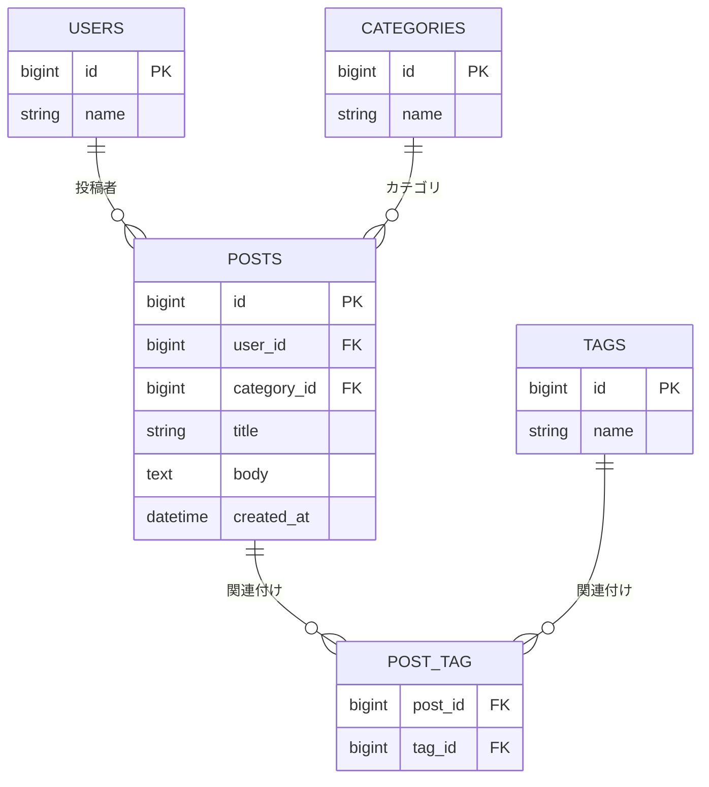

# Issue #11: ポスト検索 設計

## 概要

タイムラインに検索欄を追加し、ポストのタイトル・本文・投稿者名・トピックを検索語で部分一致検索できるようにする。検索結果は既存のタイムラインに表示し、ポストの新しい順を保つ。検索語が空の場合は全ポストを表示する。

## 受け入れ条件

- ログイン中の利用者が検索語を入力して検索すると、タイトル・本文・投稿者名・トピックのいずれかに部分一致するポストだけが新しい順に表示される。
- 検索語を空にして検索すると、すべてのポストが新しい順に表示される。
- 該当するポストがない場合、「該当するポストはありません」と表示される。
- 検索利用後もタイムライン一覧、ポストの編集・削除、リプライ、ポスト作成、編集画面の文字数制限、「編集済み」の目印、いいねは従来どおり動作する。

## 変えないもの

- ログイン必須のタイムラインと、検索条件がない場合の新しい順表示。
- ポスト詳細、作成、編集、削除、リプライ、いいねの既存動作と認可。
- 既存の画面・項目・ルート・動作（検索に必要なタイムライン上の検索欄と検索条件を除く）。
- ポスト本文の文字数上限 140 字。

## 増えるテーブル

検索機能のために新たに作成するテーブルはない。検索対象は既存の `posts`、`users`、`categories`、`tags` とその関連データを利用する。以下は検索対象の関係を示す既存テーブルの図であり、新規テーブルを表すものではない。

## 増える画面

- **タイムライン画面（既存画面の変更）**: 検索語入力欄と検索操作を追加する。結果は同じ一覧領域に表示し、検索語が空なら全件、検索結果が0件なら「該当するポストはありません」と表示する。
- 新しい独立画面は追加しない。

## 入力チェックとメッセージ一覧

| 画面 | 項目 | 必須 | 入力チェック | 表示メッセージ |
|:---|:---|:---:|:---|:---|
| タイムライン | 検索語 | いいえ | 空の場合は検索条件を適用せず全ポストを表示する。空でない場合はタイトル・本文・投稿者名・トピックを部分一致で検索する。Issue に最大長や文字種の制約は指定されていない。 | 入力エラーなし |
| タイムライン | 検索結果 | - | 該当件数が0件か判定する。 | 該当するポストはありません |

## テスト観点

| ID | 観点 | 区分 |
|:---|:---|:---|
| TC-01 | ログイン後、検索語がタイトルに部分一致するポストだけが表示される | 正常系 |
| TC-02 | 本文に部分一致するポストが表示される | 正常系 |
| TC-03 | 投稿者名に部分一致するポストが表示される | 正常系 |
| TC-04 | トピック名に部分一致するポストが表示される | 正常系 |
| TC-05 | 複数の検索対象のいずれかに一致するポストが表示され、重複表示されない | 正常系 |
| TC-06 | 検索結果が作成日時の新しい順で表示される | 正常系 |
| TC-07 | 検索語が空の場合、全ポストが新しい順で表示される | 正常系・境界値 |
| TC-08 | 一致するポストがない場合、「該当するポストはありません」と表示される | 正常系 |
| TC-09 | 未ログイン利用者がタイムラインへアクセスできない | 認証 |
| TC-10 | 検索利用後もポスト作成・編集・削除、リプライ、いいねと既存の文字数制限・編集済み表示が従来どおり動作する | 回帰 |
