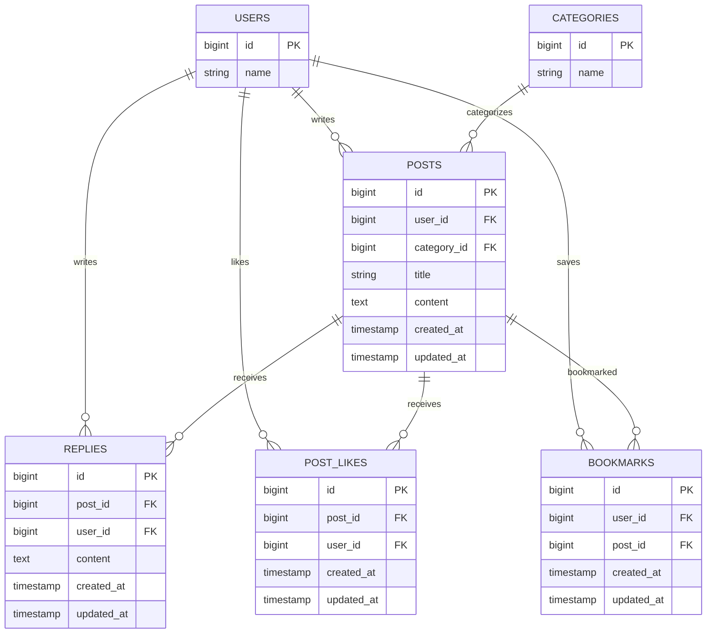

# ブックマーク機能設計（Issue #10）

## 概要

ポストをブックマークして後から専用一覧で見返せる機能を追加する。ブックマークは利用者ごとに管理し、保存した本人だけが保存状態と一覧を確認できる。自分のポストもブックマークでき、同じ操作で追加と解除を切り替える。

## 受け入れ条件

- [ ] ログイン中の利用者がタイムライン上でポストをブックマークすると、その利用者の保存データとして登録される。
- [ ] 自分のポストもブックマークできる。
- [ ] ブックマーク済みポストに同じ操作をすると、ブックマークが解除される。
- [ ] ブックマーク一覧には、ログイン中の利用者が保存したポストだけが表示される。
- [ ] 他の利用者のブックマーク一覧や保存状態は閲覧できない。
- [ ] 他の利用者のブックマーク状態は変更できない。
- [ ] 既存のタイムライン、投稿の編集・削除、リプライ、ポスト作成、編集画面の文字数制限、「編集済み」の目印、いいねが従来どおり動作する。

## 変えないもの

- ログイン必須のタイムライン・ポスト詳細表示と、ポストを新しい順に表示する動作。
- 投稿者本人だけがポストを編集・削除できる認可。
- リプライの投稿・表示・削除と、リプライ投稿者本人だけが削除できる認可。
- ポスト作成、編集画面の本文140字制限と残り文字数表示、「編集済み」の目印、いいね。
- Issue #10 で変更対象として示されていない既存の画面、項目、ルート、動作。

## 増えるテーブル

`bookmarks` テーブルを追加し、ブックマークした利用者とポストの組み合わせを保存する。利用者とポストはいずれも複数のブックマークに関連できる。同じ利用者が同じポストを重複して保存できないよう、`user_id` と `post_id` の組み合わせを一意にする。ユーザー ID はリクエスト値から決めず、ログイン中の利用者を使う。

## 増える画面

新しい専用画面はブックマーク一覧とする。既存のタイムラインにはブックマークの追加・解除操作を加える。

| 画面 | 追加・変更する内容 |
|:---|:---|
| タイムライン | 各ポストに、ログイン中の利用者の状態に応じたブックマーク操作を表示する。操作後は対象ポストの保存状態を反映する。ブックマーク一覧への導線を追加する。 |
| ブックマーク一覧 | ログイン中の利用者が保存したポストを表示する。別の利用者の保存データを一覧に含めない。 |

## 入力チェックとメッセージ一覧

ブックマーク操作ではポスト本文などの入力を受け付けない。対象ポストは既存ポストとして特定し、利用者は認証済みセッションから特定する。未認証時は既存の認証要件に従い、対象が存在しない場合は既存のポスト参照時と同様に扱う。Issue に追加の入力項目やエラーメッセージ指定はないため、新たな入力エラー文言は設けない。

| 操作 | 検証・認可 | エラーメッセージ |
|:---|:---|:---|
| ブックマーク追加・解除 | ログイン必須。保存対象は既存ポスト。利用者 ID は認証情報から設定する。 | 追加の指定なし |
| ブックマーク一覧表示 | ログイン必須。ログイン中の利用者のブックマークだけを取得する。 | 追加の指定なし |

## テスト観点

- 認証済み利用者がタイムラインからポストをブックマークでき、利用者とポストの組み合わせが保存される。
- 自分のポストもブックマークできる。
- 同じポストを再度操作するとブックマークが解除され、保存データが残らない。
- ブックマーク一覧に自分が保存したポストだけが表示され、他の利用者が保存したポストは表示されない。
- リクエストで別の利用者 ID を指定しても、その利用者の状態は参照・変更されない。
- 他の利用者の一覧や保存状態を直接指定して閲覧・変更しようとしても許可されない。
- 未認証で一覧やブックマーク操作へアクセスできない。
- 同一利用者・同一ポストの重複ブックマークが作成されない。
- タイムライン、ポストの編集・削除、リプライ、ポスト作成、編集画面の文字数制限、「編集済み」の目印、いいねが従来どおり動作する。
