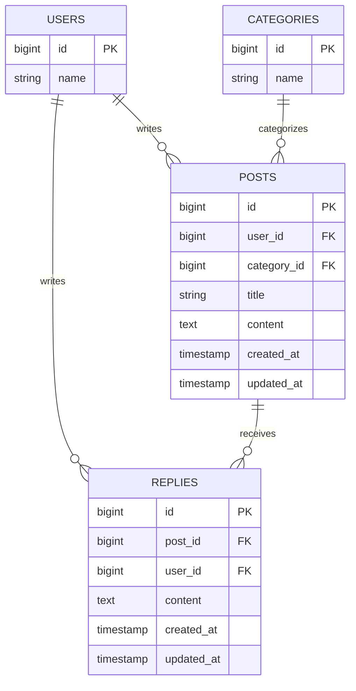

## 概要

Issue #3 のポスト投稿機能を設計する。タイムラインに「ポストを書く」入口を追加し、専用の投稿画面でタイトル・トピック・本文を入力して送信する。投稿画面と登録処理はログイン必須とし、登録時の投稿者はログイン中の利用者から設定する。登録成功後はタイムラインへ戻り、新しいポストを先頭に表示する。

投稿画面では編集画面と同じ項目と入力条件を使う。タイトルは必須・255文字以内、トピックは既存カテゴリから必須選択、本文は必須とする。投稿処理では `user_id` をリクエスト値から受け取らず、認証済みユーザーの ID を設定する。

## 受け入れ条件

- ログイン中にタイムラインを開くと、専用の投稿画面へ移動する入口が表示される。
- タイトル・トピック・本文を送信すると、ログイン中のユーザーを投稿者として保存し、タイムラインの先頭に表示する。
- 本文が空または空白だけの場合は投稿画面にエラーを表示し、ポストを作成しない。
- 作成したポストにはログイン中のユーザー名が表示され、その本人には編集・削除の操作が表示される。
- ログアウト状態で投稿画面または登録処理へアクセスすると、ログイン画面へリダイレクトされる。
- `posts` テーブルの列・型を変更せず、`database/migrations` に新しいファイルを追加しない。
- 既存どおり、他人のポストには編集・削除操作を表示せず、編集・削除URLへの直接アクセスは403にする。
- リプライ機能と編集画面の文字数制限・残り文字数表示を維持する。

## 変えないもの

- `posts` テーブルの構造と既存データ。
- タイムラインの既存ポスト一覧・詳細表示と、編集・削除の画面および処理。
- 投稿者本人だけに編集・削除を許可する認可動作。
- リプライの投稿・表示・削除の動作。
- 編集画面にある本文の文字数制限と残り文字数表示。
- 既存の投稿者名表示、トピック表示、ポストの新しい順の一覧表示。

## 増えるテーブル

新しいテーブルは増やさない。投稿データは既存の `posts` テーブルへ保存し、既存の `users` と `categories` への外部キーを使う。以下は現在のテーブル関係を示す図であり、この機能でスキーマやマイグレーションを追加するものではない。

## 増える画面

| 画面 | 内容 |
|:---|:---|
| ポスト投稿画面 | タイトル入力欄、既存カテゴリから選ぶトピック欄、本文入力欄、投稿ボタン、タイムラインへ戻るリンクを表示する。検証エラーは該当項目の近くに表示し、入力済みの値を保持する。 |

タイムラインに投稿画面へのリンクを設ける。投稿画面の表示ルートと登録ルートは認証ミドルウェアの対象とする。投稿後は既存のタイムラインを再表示し、作成されたポストを一覧の先頭に含める。

## 入力チェックとメッセージ一覧

| 画面 | 項目 | 必須 | 文字数・桁数 | 形式・値の範囲 | エラーメッセージ |
|:---|:---|:---|:---|:---|:---|
| ポスト投稿画面 | タイトル | 必須 | 255文字以内 | 文字列 | 未入力: タイトルを入力してください／255文字超: タイトルは255文字以内で入力してください |
| ポスト投稿画面 | トピック | 必須 | — | DBにあるカテゴリから1つ選択 | 未選択: トピックを選択してください／存在しない値: 選択したトピックが正しくありません |
| ポスト投稿画面 | 本文 | 必須 | 既存仕様に従う（Issueに上限指定なし） | 文字列。空文字・空白のみは不可 | 本文を入力してください |

入力エラー時は投稿画面へ戻し、エラーと入力値を表示する。本文が未入力または空白だけの場合は保存しない。投稿者 ID はフォーム入力項目にせず、認証情報から設定する。

## テスト観点

- 認証済みユーザーのタイムラインに投稿画面へのリンクが表示され、リンク先を開ける。
- 未認証ユーザーが投稿画面・登録ルートへアクセスするとログイン画面へリダイレクトされる。
- 有効な入力でポストが1件保存され、タイトル・本文・カテゴリ・認証済みユーザーの ID が記録される。
- リクエストに別の `user_id` を含めても、投稿者がログイン中のユーザーになる。
- 登録後はタイムラインへリダイレクトされ、新しいポストが先頭に表示され、投稿者名と本人用の編集・削除操作が確認できる。
- 本文の空文字・空白のみ、タイトルの未入力・255文字超、トピックの未選択・無効値でエラーになり、ポストが保存されない。
- 他人のポストには編集・削除操作が表示されず、直接アクセスも403となる既存動作を確認する。
- 既存の一覧・編集・削除、リプライ機能、編集画面の文字数制限・残り文字数表示が維持される。
- `posts` のスキーマに変更がなく、`database/migrations` に新しいファイルがない。
