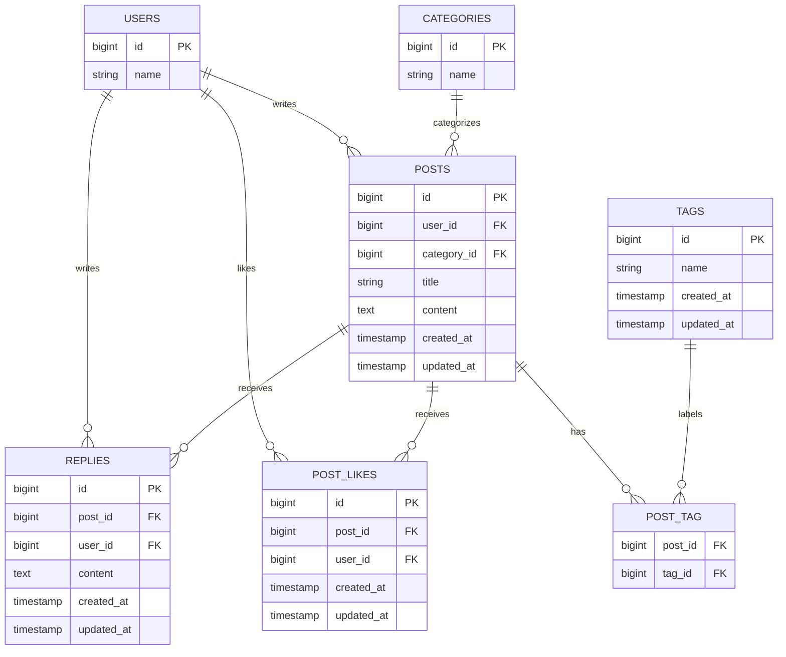

## 概要

Issue #9 に基づき、あらかじめ用意したハッシュタグをポストに付け、タイムラインをタグで絞り込めるようにする。タグは既存のトピック（お知らせ・技術メモ・雑記）とは別に扱う。タグ候補はシーダーで5件程度用意し、利用者がタグを新規作成する画面は設けない。

ポストにはタグを複数付けられ、タグを付けないポストも登録できる。タグの付け替えはポストを書いた本人だけに許可する。タイムラインはログイン必須とし、タグで絞り込んだ場合もポストを新しい順で表示する。

## 受け入れ条件

- [ ] ポストの作成画面で用意済みのタグを選んで保存すると、選択したタグがポストに紐づく。
- [ ] タグを選ばずにポストを作成すると、タグなしのポストが保存される。
- [ ] ポストの編集画面でタグを選び直して保存すると、そのポストに付くタグが選択内容に更新される。
- [ ] タイムラインを表示すると、タグ付きのポストには紐づくタグが表示され、タグなしのポストにはタグが表示されない。
- [ ] タイムラインでタグを1つ選ぶと、そのタグが付いたポストだけが新しい順に表示される。
- [ ] 他人のポストの編集画面をURLで直接開くと403になり、そのポストのタグを変更できない。

## 変えないもの

- ログイン必須のタイムラインと、ポストを新しい順に表示する動作。
- 投稿者本人だけがポストを編集・削除できる認可。
- リプライの投稿・表示・削除と、リプライ投稿者本人だけが削除できる認可。
- ポスト作成機能と、編集画面の本文140字制限および残り文字数表示。
- 「編集済み」の目印と、いいねの表示・操作。
- 既存の画面・項目・ルート・動作のうち、Issue #9 で変更対象とされていないもの。

## 増えるテーブル

既存の `posts` テーブルにはタグ情報を直接追加せず、タグ候補を格納する `tags` とポストとの対応を格納する中間テーブル `post_tag` を追加する。1つのポストに複数タグを紐づけられ、1つのタグは複数のポストに紐づく。タグ候補はシーダーから登録し、トピックのカテゴリとは別のデータとして管理する。

`post_tag` は `post_id` と `tag_id` の組み合わせを一意にし、どちらもそれぞれの親テーブルへの外部キーとする。タグ名は識別できる文字列として保存する。削除時の連動方法など Issue に指定のない仕様は追加しない。

## 増える画面

新しい画面は追加しない。既存画面を次のように拡張する。

| 画面 | 追加・変更する内容 |
|:---|:---|
| ポスト作成画面 | シーダーで用意したタグを複数選択できる入力欄を表示する。選択は任意とする。タグの新規作成手段は設けない。 |
| ポスト編集画面 | ポストに現在付いているタグを選択済みとして表示し、投稿者本人が選び直して保存できるようにする。 |
| タイムライン | タグ付きポストにタグ名を表示する。タグ名を選択する操作を設け、選択したタグでポストを絞り込む。選択解除時は全ポストを表示する。 |

タグ選択欄にはシーダー登録済みのタグだけを表示する。タグ名はトピック名（お知らせ・技術メモ・雑記）と区別できるものを5件程度用意する。

## 入力チェックとメッセージ一覧

タグ選択は任意とし、選択されている場合は配列として受け取り、各値が `tags` テーブルに存在することを確認する。無効なタグ ID は保存せず、画面に日本語のエラーメッセージを表示する。

| 画面 | 項目 | 必須 | 文字数・件数 | 形式・値の範囲 | エラーメッセージ |
|:---|:---|:---|:---|:---|:---|
| ポスト作成・編集画面 | タグ | 任意 | シーダー登録済みの候補から複数選択 | 選択値は配列で、各 ID が `tags` に存在すること | 選択したタグが正しくありません |

## テスト観点

- タグ候補がシーダーで5件程度登録され、トピックとは別の候補として作成画面・編集画面に表示される。
- 作成画面で複数タグを選択して保存すると、選択したタグとポストの対応が保存される。
- 作成画面でタグを選択せずに保存すると、タグなしのポストが作成される。
- 編集画面でタグを変更して保存すると、ポストに紐づくタグが選択内容に置き換わる。
- タイムラインでタグ付きポストにはタグが表示され、タグなしポストにはタグが表示されない。
- タイムラインでタグを選ぶと、そのタグが付いたポストだけが新しい順で表示される。該当ポストがない場合はポストが表示されない。
- タグとして存在しない ID を送信すると日本語の入力エラーになり、タグの紐づけは変更されない。
- 他人のポストの編集画面への直接アクセスが403となり、タグを更新できない。
- 自分のポストの編集・削除、リプライ、ポスト作成、本文の文字数制限、「編集済み」の目印、いいねが従来どおり動作する。
