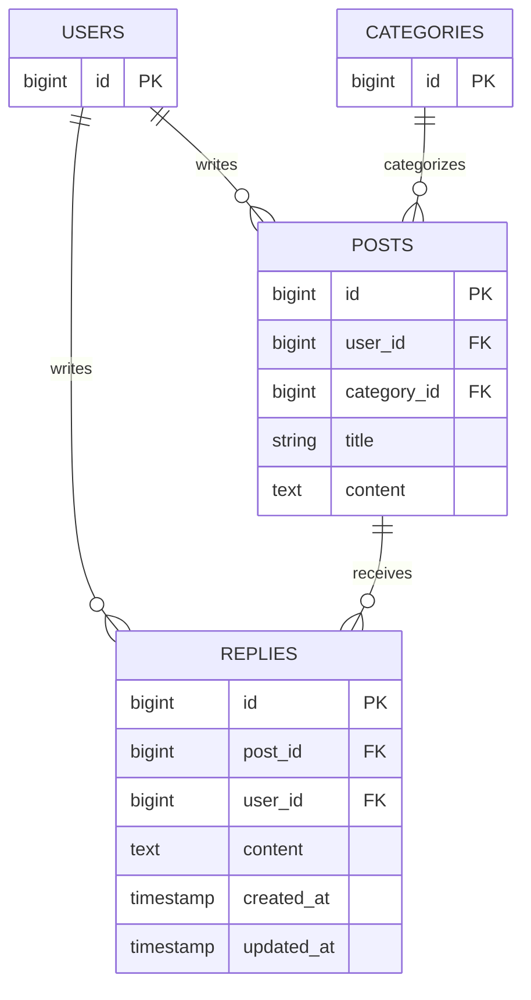

# リプライ機能設計（Issue #1）

## 概要

ログイン中の利用者がポスト詳細画面でリプライを投稿し、自分のリプライを削除できるようにする。投稿の一覧表示・編集・削除の既存動作は維持する。

詳細画面は `GET /posts/{post}`、リプライ登録は `POST /posts/{post}/replies`、削除は `DELETE /posts/{post}/replies/{reply}` を想定する。いずれも既存の投稿ルートと同じく認証必須とする。詳細画面には対象ポストとリプライを古い順に表示し、登録後は同じ詳細画面へ戻る。

## 受け入れ条件

- タイムラインからポストを開くと、ポスト本体とそのポストへのリプライ一覧が表示される。
- 本文を入力して送信すると、ログイン中の利用者名とともにリプライ一覧に追加される。
- 本文が空、または空白文字だけの場合は入力エラーを表示し、リプライを登録しない。
- 自分のリプライには削除操作が表示され、削除できる。
- 他人のリプライには削除操作を表示せず、削除リクエストを直接送っても拒否される。
- リプライ削除の所有者判定は `PostPolicy` と同様に、ログイン中の利用者 ID とリプライの投稿者 ID が一致するかで行う。

## 変えないもの

- タイムラインの既存の一覧表示、投稿編集、投稿削除の動作と画面。
- 投稿の編集・削除権限。引き続き `PostPolicy` が投稿者本人かどうかで判定する。
- 既存の `posts` テーブルの構造。

## 増えるテーブル

`replies` テーブルを追加する。リプライは必ず1つのポストと1人の利用者に属する。ポストまたは利用者が削除された場合、そのリプライも削除する。

`replies` の `post_id` と `user_id` は外部キーとし、`content` は本文を保存する。作成・更新日時も記録する。

## 増える画面

| 画面 | 内容 |
|:---|:---|
| ポスト詳細画面 | ポストの投稿者・日時・カテゴリ・タイトル・本文、リプライ一覧、リプライ入力欄と送信ボタンを表示する。各リプライには投稿者名と本文を表示し、本人のリプライだけ削除ボタンを表示する。 |

タイムラインの各ポストから詳細画面へ移動できるようにする。入力エラーは入力欄の近くに表示し、エラー時は入力内容を保持する。

## 入力チェックとメッセージ一覧

| 画面 | 項目 | 必須 | 文字数・桁数 | 形式・値の範囲 | エラーメッセージ |
|:---|:---|:---|:---|:---|:---|
| ポスト詳細画面 | リプライ本文 | 必須 | 上限なし（Issue の要件に指定なし） | 文字列。空文字・空白のみは不可 | 本文を入力してください |

検証に失敗したときは保存せず、ポスト詳細画面を再表示する。空白のみの本文も未入力として扱う。

## テスト観点

- 認証済み利用者がポスト詳細を開くと、対象ポストと紐づくリプライだけが表示される。
- リプライは古いものから順に表示され、投稿者名と本文が確認できる。
- 有効な本文を送信すると、ログイン中の利用者と対象ポストに紐づくリプライが1件保存され、詳細画面に表示される。
- 空文字および空白のみの本文はエラーとなり、データベースに保存されない。
- 本人のリプライ削除は成功し、一覧から消える。
- 他人のリプライ削除リクエストは拒否され、対象データが残る。
- リプライを持たないポストでも詳細画面が表示され、空の一覧状態を確認できる。
- タイムラインの一覧・既存の投稿編集・投稿削除が引き続き利用できる。
